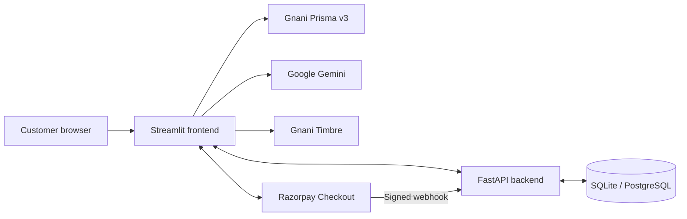

# VoiceKirana — Multilingual AI Grocery Ordering Assistant

> Speak naturally. Discover groceries across local shops. Review your cart and order with clarity.

VoiceKirana is a multilingual grocery-shopping assistant. Customers can speak or type a grocery request, review AI-extracted items in an editable cart, explore shop catalogues, check inventory, confirm orders, and follow order and payment status.

The application combines **FastAPI**, **Streamlit**, **SQLite/PostgreSQL**, **Gnani AI speech services**, **Google Gemini**, and **Razorpay**.

## Features

### Voice and AI
- Browser microphone input through the Streamlit interface.
- **Gnani Prisma v3** speech-to-text and automatic language identification (Auto-LID) for supported Indic languages and English.
- **Google Gemini 3.5 Flash-Lite** structured extraction of grocery names, quantities, units, brands, variants, and additional instructions.
- Original product wording is retained; incomplete or ambiguous details are flagged for customer review.
- Extracted items populate an editable cart. Voice transcription and extraction do not place orders or reserve stock.
- **Gnani Timbre** text-to-speech for spoken inventory responses.

### Product discovery and inventory
- Active, customer-visible shop directory and shop-specific catalogues.
- Search across shop offers, with quick-search shortcuts shown when matching catalogue products exist. These shortcuts are not a fixed product-category database.
- Shop-specific prices, availability, product aliases, and alternate/regional names.
- Multiple editable cart items, including custom products and optional normalized names, brands, and variants.
- Inventory validation and cross-shop comparison, including complete and partial matches. A comparison is only a preview and does not reserve stock.

### Customer accounts and orders
- Customer registration, login, profile editing, and optional remember-me sessions.
- Customer-scoped order history and individual order lookup.
- Create, view, update, and delete saved addresses, including a default address.
- Idempotent order confirmation protects against duplicate requests and retries.
- Shop-configured automatic acceptance or manual shop acceptance/rejection.
- Transactional inventory reservation on acceptance and release for eligible shop-side cancellations.

**Address limitation:** Saved addresses are managed in the customer account, but a selected address is not yet attached to an individual order during order confirmation.

### Payments
- Razorpay Checkout for eligible customer-owned orders.
- Payment attempts can be created only after the order is confirmed/accepted.
- Server-side Checkout signature and payment verification.
- Signed Razorpay webhook processing for payment and supported refund events, with duplicate-event protection.
- The example configuration uses **Razorpay Test Mode**. The integration does not imply that live payments or a production deployment are configured.

### Shop and administrator operations
- Shop-member login with JWT access tokens, active memberships, and role-based authorization.
- Shop inventory listing and updates, product registration, and product-alias management.
- Administrator-protected shop registration, owner creation, and customer-visibility management.

## Architecture



Streamlit provides the customer-facing experience. FastAPI validates requests, enforces authentication and ownership rules, coordinates catalogue, inventory, order and payment operations, and accesses the configured database. External AI and payment providers do not replace backend validation or authorization.

## Technology stack

| Layer | Technology |
|---|---|
| Backend API | Python, FastAPI, Uvicorn |
| Frontend | Streamlit |
| Database | SQLite, PostgreSQL; Psycopg 3 |
| Validation | Pydantic |
| Authentication | JWT, Argon2 |
| Speech | Gnani Prisma v3, Gnani Timbre |
| AI extraction | Google Gemini 3.5 Flash-Lite (`google-genai`) |
| Payments | Razorpay Checkout and signed webhooks |
| HTTP client | Requests |
| Configuration | Python-dotenv |
| Tests and CI | Pytest, HTTPX, GitHub Actions |

## Repository structure

```text
VoiceKirana/
├── .github/workflows/tests.yml
├── .streamlit/config.toml
├── backend/
│   ├── main.py
│   ├── database.py
│   ├── auth_dependencies.py
│   ├── security.py
│   ├── models/
│   └── services/
├── frontend/
│   ├── app.py
│   └── razorpay_checkout.py
├── tests/
├── .env.example
├── .gitignore
├── requirements.txt
└── README.md
```

## Requirements

- Python **3.12** (used by the current GitHub Actions workflow).
- Git.
- Gnani credentials for Prisma and Timbre.
- Google Gemini API key.
- VoiceKirana server-to-server API token and strong authentication secrets.
- PostgreSQL connection URL when using PostgreSQL.
- Razorpay test credentials to exercise checkout.

## Local setup (Windows PowerShell)

Run the commands from the cloned repository directory.

### 1. Clone and create a virtual environment

```powershell
git clone https://github.com/123saianu/VoiceKirana.git
cd VoiceKirana
py -3.12 -m venv venv
.\venv\Scripts\Activate.ps1
```

If PowerShell blocks activation, use the execution-policy approach approved for your machine, or run `venv\Scripts\python.exe` directly.

### 2. Install dependencies and create `.env`

```powershell
python -m pip install --upgrade pip
python -m pip install -r requirements.txt
Copy-Item .env.example .env
```

Edit `.env` with your own values. Never commit it or share credentials in screenshots, logs, or issue reports.

## Environment variables

The tracked `.env.example` is the reference for configuration keys. Set values in a private local `.env` or your hosting provider's secret manager.

| Variable | Purpose |
|---|---|
| `BACKEND_URL` | FastAPI base URL reachable by the Streamlit process; local default is `http://127.0.0.1:8001`. |
| `APP_NAME` | Application name/configuration value. |
| `GNANI_API_KEY_ID` | Gnani API key identifier used by Prisma. |
| `GEMINI_API_KEY` | Google Gemini API key for structured extraction. |
| `VOICEKIRANA_API_TOKEN` | Internal server-to-server API token for protected service routes. |
| `DATABASE_URL` | PostgreSQL URL; leave empty to use the configured SQLite database. |
| `JWT_SECRET_KEY` | High-entropy secret for signing authentication tokens. |
| `VOICEKIRANA_ADMIN_TOKEN` | Secret for administrator-only operations. |
| `VOICEKIRANA_COOKIE_SECURE` | Secure-cookie setting; enable when serving over HTTPS. |
| `RAZORPAY_MODE` | Payment mode; the example uses `test`. |
| `RAZORPAY_KEY_ID` | Razorpay key ID. |
| `RAZORPAY_KEY_SECRET` | Razorpay key secret. |
| `RAZORPAY_WEBHOOK_SECRET` | Secret used to verify webhook signatures. |

### Database configuration

- An empty `DATABASE_URL` selects the configured SQLite database path.
- A PostgreSQL URL selects PostgreSQL through Psycopg.
- Use a dedicated test database for migrations, destructive checks, and failure-injection tests.
- Hosted deployments should use persistent managed PostgreSQL storage; do not rely on an ephemeral application filesystem for SQLite persistence.

Never commit `.env`, credential-bearing database URLs, API keys, payment secrets, generated tokens, or database backups.

## Run the application

Run the backend and frontend in separate PowerShell terminals and keep both running while using the app.

### 1. FastAPI backend (terminal 1)

```powershell
.\venv\Scripts\Activate.ps1
python -m uvicorn backend.main:app --host 127.0.0.1 --port 8001
```

Health check: `http://127.0.0.1:8001/health`  
Interactive API documentation: `http://127.0.0.1:8001/docs`

Expected health response:

```json
{"status": "ok", "service": "voicekirana-backend"}
```

### 2. Streamlit frontend (terminal 2)

```powershell
.\venv\Scripts\Activate.ps1
python -m streamlit run frontend/app.py
```

Open the local URL printed by Streamlit, normally `http://localhost:8501`. Ensure `BACKEND_URL` points to the API address reachable by the machine running Streamlit.

## Application workflows

### Voice-to-cart

1. The customer records a grocery request using the browser microphone.
2. Gnani Prisma transcribes speech and returns language metadata when available.
3. Gemini extracts structured grocery items; validation flags uncertain details.
4. The customer reviews and edits the cart before continuing.

### Catalogue and inventory

1. The customer selects a checkout shop or explores products across visible shops.
2. Catalogue results show shop-specific offers, prices, and availability.
3. The customer adds catalogue products or enters custom items and quantities.
4. The backend validates the request and checks inventory.
5. Cross-shop comparison is a preview only; it does not reserve inventory or create an order.

### Order confirmation and shop response

The behavior depends on the selected shop's `auto_accept_orders` setting:

- **Automatic acceptance:** the backend creates the order, reserves the required stock, and changes the status to `confirmed` in one transaction. If all stock cannot be reserved, the transaction rolls back.
- **Manual acceptance:** the order is saved as `pending` without reserving stock. An authorized shop owner or manager can accept or reject it. Acceptance reserves all required inventory transactionally; rejection records a reason.

A successful confirmation response does not always mean shop acceptance. Customers should check the actual order status in history or order lookup. Inventory checking and comparison are not reservations.

### Payment, tracking, and cancellation

- Payment starts only after an order is confirmed/accepted.
- The authenticated customer creates a Razorpay attempt; the backend verifies the Checkout signature and payment details.
- Signed webhooks update supported payment and refund states. A webhook does not accept an order or reserve grocery stock.
- Signed-in customers can view order history and look up an order by reference.
- Eligible shop-side cancellations release applicable reservations. Customer self-service cancellation is not enabled in the customer interface.
- Delivery partner assignment, live location, and delivery milestones are not implemented.

## API overview

Use `/docs` for the live OpenAPI schema, request models, and response details. Protected routes require the appropriate authentication mechanism.

| Method | Endpoint | Purpose |
|---|---|---|
| GET | `/health` | Backend health check. |
| GET | `/shops` | List active customer-visible shops. |
| GET | `/shops/{shop_id}/catalogue` | Retrieve a shop's public catalogue. |
| GET | `/catalogue/all` | Retrieve product groups and offers across visible shops. |
| POST | `/orders/preview` | Validate a structured grocery request. |
| POST | `/inventory/check?shop_id={id}` | Check a request against one shop's inventory. |
| POST | `/inventory/compare` | Compare a cart across customer-visible shops. |
| POST | `/orders/confirm?shop_id={id}` | Save/confirm through the internal service API. |
| GET | `/orders/history?shop_id={id}` | Retrieve orders for an authorized shop. |
| GET | `/orders/{order_reference}?shop_id={id}` | Retrieve an order for an authorized shop. |
| POST | `/orders/{order_reference}/accept?shop_id={id}` | Accept a pending order and reserve stock. |
| POST | `/orders/{order_reference}/reject?shop_id={id}` | Reject a pending order with a reason. |
| POST | `/orders/{order_reference}/cancel?shop_id={id}` | Cancel an eligible order for an authorized shop. |
| GET | `/shops/{shop_id}/inventory` | List an authorized shop's inventory. |
| POST | `/shops/{shop_id}/products` | Register a shop product. |
| PUT | `/shops/{shop_id}/inventory/{product_id}` | Update price, stock, or availability. |
| POST | `/shops/{shop_id}/products/{product_id}/aliases` | Add a product alias. |
| POST | `/auth/login` | Shop-member login and JWT issuance. |
| GET | `/auth/me` | Retrieve the authenticated user's profile and memberships. |
| POST | `/admin/shops` | Register a shop (administrator only). |
| POST | `/admin/shops/owners` | Create a shop-owner account (administrator only). |
| PUT | `/admin/shops/{shop_id}/visibility` | Change customer visibility (administrator only). |
| POST | `/customers/register` | Register a customer. |
| POST | `/customers/login` | Customer login. |
| GET/PATCH | `/customers/me` | Retrieve or update the authenticated customer's profile. |
| GET/POST | `/customers/addresses` | List or create saved customer addresses. |
| PUT/DELETE | `/customers/addresses/{address_id}` | Update or delete an owned address. |
| POST | `/customers/session/restore` | Rotate a remember-me token and restore a session. |
| POST | `/customers/session/logout` | Revoke a remember-me session. |
| POST | `/customers/orders/confirm?shop_id={id}` | Confirm an authenticated customer's order (idempotency key required). |
| GET | `/customers/orders` | List the authenticated customer's orders. |
| GET | `/customers/orders/{order_reference}` | Retrieve an order owned by the authenticated customer. |
| POST | `/customers/orders/{order_reference}/payments` | Create a payment attempt for an eligible order (idempotency key required). |
| POST | `/customers/orders/{order_reference}/payments/verify` | Verify the customer's Razorpay Checkout response. |
| POST | `/webhooks/razorpay` | Receive and verify Razorpay payment/refund webhook events. |

### Authentication expectations

- Customer endpoints require a customer JWT and enforce customer/order/address ownership.
- Shop-member endpoints require a JWT and active membership with the required role for the shop.
- Administrator operations require the `X-Admin-Token` header.
- Protected internal service routes use `X-API-Key`; the shared token must remain server-side.
- Payment verification and webhook processing are verified on the backend. A browser success callback alone is not proof of payment.

## Security model

- Passwords are hashed with Argon2; authenticated users receive signed JWT access tokens.
- Customer and shop-member principals are separated and protected by role and ownership checks.
- Customer data is scoped to the authenticated customer; shop operations are scoped to active shop membership.
- Administrator operations use a separate administrator token.
- Internal API tokens are for server-to-server use and must not be embedded in browser-side code.
- Razorpay Checkout and webhook signatures are verified server-side. Webhook request bodies are verified before JSON processing, and event identifiers protect against duplicate processing.
- `.env` and common database artifacts are excluded by `.gitignore`.

For hosted use, configure HTTPS, strong unique secrets, restricted secret access, persistent PostgreSQL, and `VOICEKIRANA_COOKIE_SECURE=true`. Keep Razorpay in Test Mode until the production domain, credentials, webhook URL, and end-to-end payment flow have been separately configured and verified.

## Testing and continuous integration

### Local checks

Run from the repository root with the virtual environment active:

```powershell
python -m compileall frontend backend tests
python -m pytest -q
```

The test suite covers authentication, customer sessions and ownership, catalogue and inventory operations, order validation and lifecycle, database transactions and migrations, idempotency, Razorpay payments/refunds, and AI/speech service behavior.

Live Gnani, Gemini, and Razorpay calls require provider credentials and configuration. Automated tests use controlled test inputs and do not prove that external production accounts are configured. PostgreSQL runtime checks are separate from the ordinary test suite and should use a dedicated test database.

### GitHub Actions

The workflow `.github/workflows/tests.yml` runs on pushes to `main`, pull requests targeting `main`, and manual dispatch. It uses Ubuntu and Python 3.12, installs `requirements.txt`, compiles frontend/backend/tests, and runs Pytest. CI uses dummy test-only values and read-only repository content permissions. Never add production secrets to CI test variables.

A local test pass and a GitHub Actions pass are separate results. Check the repository's Actions tab for the latest hosted run.

## Deployment readiness

The repository contains local run instructions and CI, but **no provider-specific deployment manifest** (such as a Dockerfile, Render Blueprint, Railway configuration, or Procfile). A GitHub push does not automatically deploy the application.

Before exposing a hosted application:

1. Configure separate FastAPI and Streamlit services with the selected hosting provider.
2. Use persistent managed PostgreSQL and set `DATABASE_URL`.
3. Set `BACKEND_URL` to the deployed API address reachable from Streamlit.
4. Configure all secrets in the provider's secret manager; do not upload `.env`.
5. Enable HTTPS and set `VOICEKIRANA_COOKIE_SECURE=true`.
6. Configure the Razorpay webhook URL as the deployed `/webhooks/razorpay` endpoint and set the matching webhook secret.
7. Keep Razorpay in Test Mode for acceptance testing. Enable live mode only after deliberate production approval and verification.
8. Test registration/login, microphone permissions, product discovery, cart validation, both shop-acceptance paths, payment verification, webhooks, and refunds on the hosted environment.
9. Verify database persistence across restarts and test backup/restore procedures.

A successful CI run verifies automated tests; it does not verify or create a public deployment.

## Implementation status and limitations

### Implemented in the repository

- Gnani Prisma v3 Auto-LID/speech-to-text, Gemini structured grocery extraction, and Gnani Timbre speech generation.
- Editable cart with arbitrary grocery details and clarification handling.
- Shop catalogues, cross-shop search, quick searches, product aliases, prices, stock, and availability.
- SQLite/PostgreSQL support, database transactions, schema constraints, and rollback handling.
- Shop-owner/customer authentication, JWTs, Argon2 password hashing, shop memberships, and role-based access.
- Customer profiles, remember-me sessions, saved-address management, customer-owned orders, history, and lookup.
- Idempotent order confirmation, automatic/manual shop acceptance, rejection, transactional stock reservation, and eligible reservation release.
- Razorpay Checkout integration, server-side verification, and signed payment/refund webhooks.
- Streamlit customer interface and GitHub Actions CI.

### Not implemented or not yet production-verified

- Delivery partner assignment, live delivery location, and delivery status milestones.
- Customer self-service order cancellation in the customer interface.
- Attaching a selected saved address to an order during confirmation.
- Voice-driven order modification, reordering, and general grocery Q&A beyond new-order extraction.
- Provider-specific deployment configuration or a verified public production deployment.
- Production/live Razorpay operation; the example configuration is Test Mode.

These distinctions are intentional: a repository integration does not mean a feature has been publicly deployed or production-certified.

## Contributing

1. Create a focused branch for each change.
2. Keep credentials, `.env`, database files, and local test artifacts out of commits.
3. Make focused changes and add or update tests.
4. Run compilation, `git diff --check`, and relevant tests before opening a pull request.
5. Review the staged diff and stage only intended files; avoid broad staging commands when local helper files or test data are present.

For bug reports, include steps to reproduce and relevant error details. Remove tokens, passwords, customer information, and private database details before sharing logs.

---

**Repository:** [123saianu/VoiceKirana](https://github.com/123saianu/VoiceKirana)
